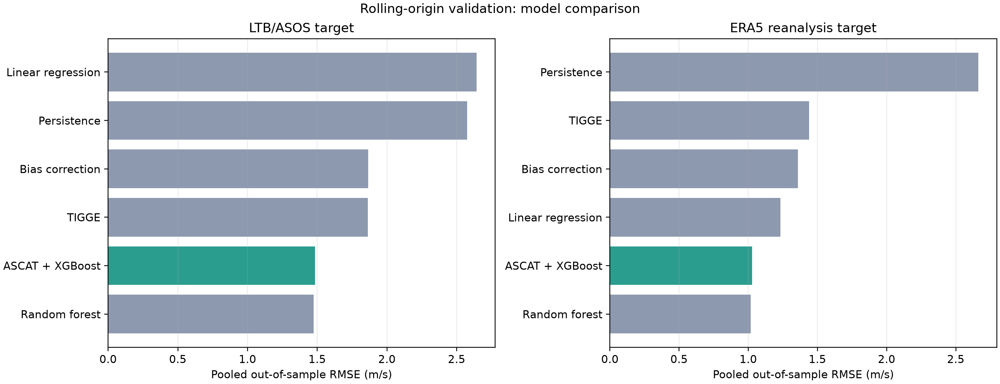
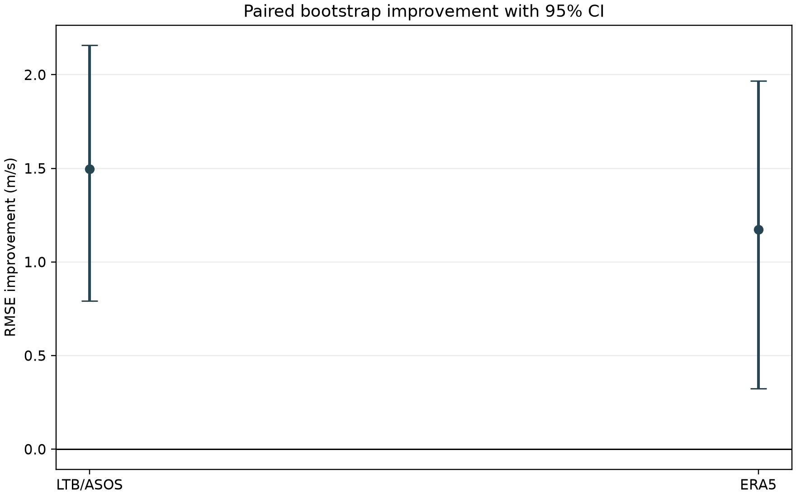
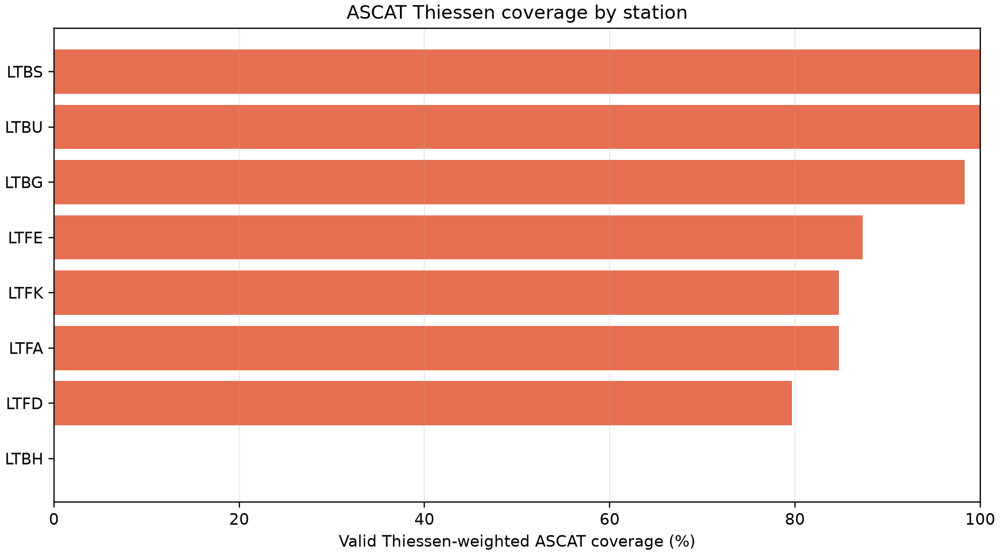

# ASCAT Destekli TIGGE Rüzgar Hata Düzeltmesi

Bu klasör, **12 saatlik TIGGE rüzgar tahminlerinin**, tahmin başlangıç zamanındaki ASCAT gözlemleri ve ASOS/LTB istasyonlarıyla değerlendirilmesini içeren pilot makale çıktısını barındırır.

## İndirilebilir makale

- [PDF makale raporu](./wind_correction_output/wind_correction_paper.pdf)
- [LaTeX kaynak dosyası](./wind_correction_paper.tex)

LaTeX PDF’si üretmek için:

```bash
pdflatex wind_correction_paper.tex
```

Bu ortamda `pdflatex` bulunmadığı için PDF, aynı metrik ve grafiklerle doğrudan oluşturulmuştur. LaTeX kaynağı gerçek makale düzeni ve formülasyonları içerir.

## Özet

TIGGE tahmin çevrimi 12:00’da başlatılmış, aynı başlangıç zamanındaki ASCAT rüzgar gözlemi feature olarak kullanılmış ve +12 saat sonraki ERA5/ASOS değerleriyle doğrulama yapılmıştır. ASCAT hücreleri istasyonlara Thiessen/Voronoi bölgeleriyle atanmış, enlem alan düzeltmesi `cos(latitude)` ile yapılmıştır. XGBoost, TIGGE tahmin hatasını öğrenmiştir.

Rolling-origin doğrulamada:

| Hedef | TIGGE RMSE | TIGGE + ASCAT + XGBoost RMSE | İyileşme |
|---|---:|---:|---:|
| LTB/ASOS | 2.988 m/s | 1.432 m/s | %52.07 |
| ERA5 | 2.386 m/s | 1.192 m/s | %50.04 |

Newey–West varyans düzeltmeli Diebold–Mariano t-testi sonuçları:

| Hedef | RMSE iyileşmesi | %95 bootstrap aralığı | DM p-değeri |
|---|---:|---:|---:|
| LTB/ASOS | 1.498 m/s | 0.793–2.158 m/s | 0.0163 |
| ERA5 | 1.174 m/s | 0.325–1.966 m/s | 0.1057 |

LTB hedefinde iyileşme hem `%5` hem `%10` anlamlılık düzeyinde istatistiksel olarak anlamlıdır (`p=0.0163`). ERA5 hedefinde iyileşme yönü güçlü olsa da `%10` düzeyinde dahi anlamlı değildir (`p=0.1057`). p-değerleri, lag-1 Newey–West varyans tahmini kullanılarak `n - 1` serbestlik dereceli Student t dağılımından iki taraflı hesaplanmıştır.

> **Bilimsel kapsam:** Sonuçlar Ocak 2021 ve 18 bağımsız test örneğine dayanan pilot bulgulardır. Mevsimsel ve yıllararası genelleme için daha uzun TIGGE dönemi gereklidir.

## Formülasyonlar

10 m rüzgar hızı:

$$
U = \sqrt{u_{10}^{2}+v_{10}^{2}}
$$

TIGGE hata hedefi:

$$
e_t = U_t^{ERA5} - U_t^{TIGGE}
$$

XGBoost düzeltmesi:

$$
\widehat{U}_t^{corr}
= U_t^{TIGGE}+\widehat{e}_t(X_t)
$$

Thiessen alan ağırlıklı ASCAT:

$$
\overline{U}_{s,t}^{ASCAT}
=
\frac{\sum_{j\in V_s}\cos(\phi_j)U_{j,t}^{ASCAT}}
{\sum_{j\in V_s}\cos(\phi_j)}
$$

Değerlendirme:

$$
RMSE=\sqrt{\frac{1}{n}\sum_{i=1}^{n}(\widehat{U}_i-U_i)^2}
$$

$$
MAE=\frac{1}{n}\sum_{i=1}^{n}|\widehat{U}_i-U_i|
$$

Z-skoru:

$$
z_i=\frac{x_i-\bar{x}}{s_x}
$$

## Grafikler







## Ham sonuçlar

- [Rolling tüm model metrikleri](./wind_correction_output/paper_rolling_metrics.csv)
- [Rolling katman metrikleri](./wind_correction_output/paper_rolling_fold_metrics.csv)
- [Tüm tahminler](./wind_correction_output/paper_rolling_predictions.csv)
- [Bootstrap ve DM sonuçları](./wind_correction_output/paper_significance.csv)
- [Rolling-origin veri sızıntısı denetimi](./wind_correction_output/paper_leakage_audit.csv)
- [Thiessen kapsamı](./wind_correction_output/paper_thiessen_coverage.csv)
- [Z-skorları](./wind_correction_output/ltb_thiessen_zscores.csv)
- [İstasyon-temelli eğitim tablosu](./wind_correction_output/ltb_thiessen_table.csv)

## Üretilen tanılayıcı görseller

LaTeX dosyasındaki beş placeholder gerçek veri çıktılarıyla değiştirilmiştir:

1. [Türkiye/Akdeniz çalışma alanı ve ASOS istasyonları](./wind_correction_output/figures/study_area_asos_stations.png)
2. [ASCAT grid ve Thiessen bölgeleri](./wind_correction_output/figures/ascat_grid_thiessen.png)
3. [TIGGE, ASCAT, LTB ve ERA5 zaman serileri](./wind_correction_output/figures/wind_time_series.png)
4. [İstasyon bazlı RMSE farkları](./wind_correction_output/figures/station_rmse_difference.png)
5. [10 m rüzgar hızları ve hata dağılımları](./wind_correction_output/figures/wind_profiles_error_distributions.png)
6. [LTB tahmin ve gerçekleşen değer zaman serileri](./wind_correction_output/figures/ltb_forecast_timeseries.png)
7. [LTB tahminlerinin noktasal saçılımı](./wind_correction_output/figures/ltb_forecast_scatter.png)

Veri setinde farklı düşey seviyeler bulunmadığı için beşinci görsel gerçek bir
düşey rüzgar profili yerine mevcut 10 m rüzgar hızlarının dağılımını ve
ERA5--TIGGE hata dağılımını göstermektedir.

LTB tanılayıcı grafiklerinde ASCAT--XGBoost düzeltilmiş tahminleri yalnızca
rolling-origin dış örnek test zamanlarında gösterilir. Böylece eğitim
zamanlarına ait başarı ölçümleri görsel olarak test sonuçlarıyla karıştırılmaz.

## Yeniden üretim

```bash
python evaluate_ltb_thiessen.py
python paper_validation_protocol.py
python generate_paper_outputs.py
```

`generate_paper_outputs.py`, sistem Python'ındaki NumPy/Matplotlib ABI
uyumsuzluğunu önlemek için mevcutsa otomatik olarak `.venv/bin/python`
ortamında çalışır. İsterseniz ortamı doğrudan etkinleştirerek de çalıştırabilirsiniz:

```bash
source .venv/bin/activate
python generate_paper_outputs.py
```

İstatistiksel sonuçların yeniden üretilebilmesi için rastgele tohum `42`, bootstrap tekrar sayısı `2000` ve rolling katman sayısı `5` olarak sabitlenmiştir.

### Veri sızıntısı (data leakage) denetimi

Her rolling-origin katmanında eğitim kayıtları yalnızca test katmanının ilk
geçerlilik zamanından önceki kayıtlarla oluşturulmuştur (`max(train.valid_time) <
min(test.valid_time)`). Eğitim ve test geçerlilik zamanlarının kesişmediği,
`initialization_time <= valid_time` koşulunun sağlandığı, özellik listesinin
hedef/hata sütunlarını içermediği ve özellik değerlerinin sonlu olduğu otomatik
olarak denetlenir. Denetimin katman bazındaki çıktısı
`paper_leakage_audit.csv` dosyasına yazılır.
